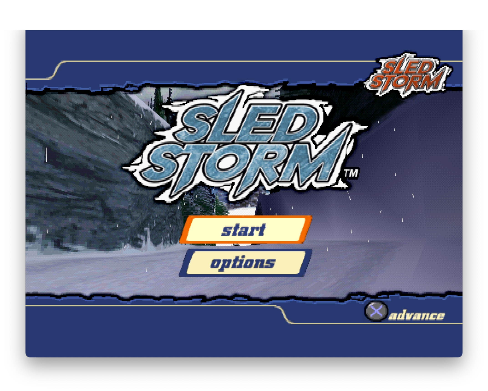
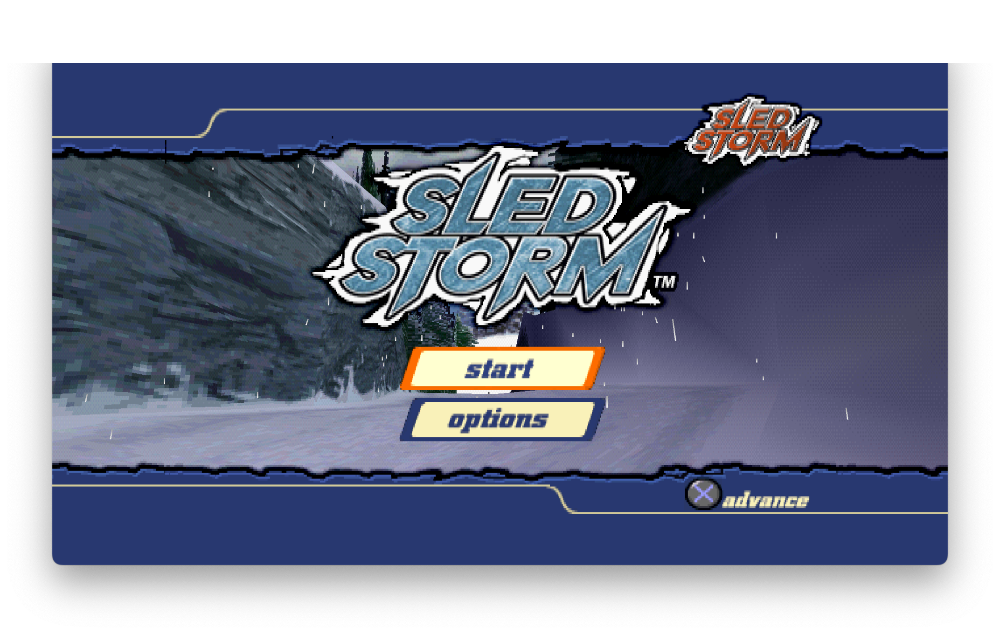
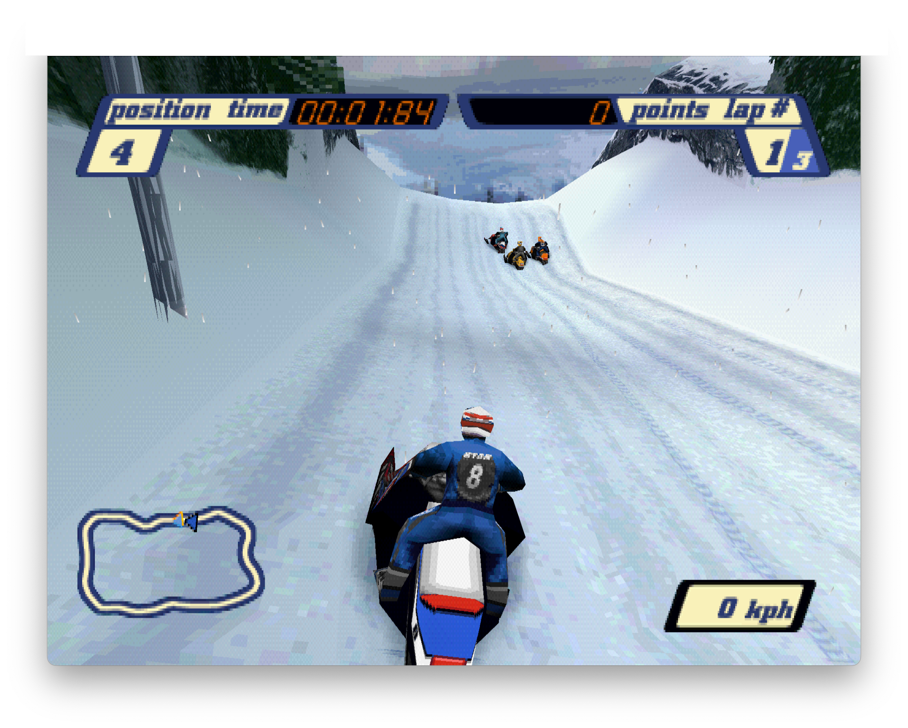
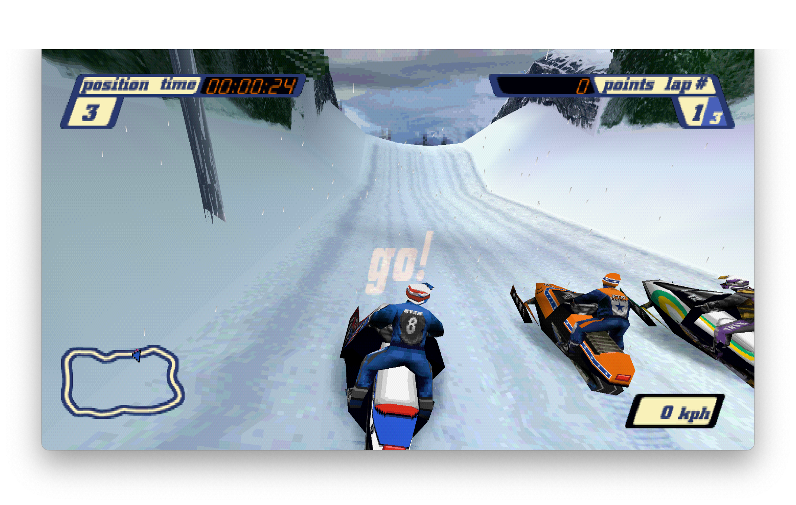

# SledStorm Recompiled

**Snowmobile racing from 1999, recompiled for modern systems. Now in native 16:9.**

*Sled Storm* (PlayStation, 1999), statically recompiled into a native
executable for Windows, Linux and macOS, with optional native widescreen.

<!-- retcomm-readme-metrics -->
[](https://github.com/PeriBluGaming/SledStormPSXRecomp/releases)
[](https://github.com/PeriBluGaming/SledStormPSXRecomp/releases/latest)
[](https://github.com/PeriBluGaming/SledStormPSXRecomp/releases/latest)
<!-- /retcomm-readme-metrics -->

## Highlights

- **Native 16:9 widescreen**: single-player races show more of the track at
  the sides, rendered wide instead of stretched.
- **Widescreen menus**: the menus with a live 3D background open up to the
  full 16:9 screen.
- **Edge-aligned HUD**: an optional layout that moves the race HUD to the
  edges of the wide screen.
- **Original 4:3 whenever you want it**: every enhancement is optional and
  off by default.
- **No retail BIOS needed**: the open-source OpenBIOS is bundled.

> [!IMPORTANT]
> **You need your own copy of the game.** SledStorm Recompiled contains no
> disc image and no retail BIOS. You supply a disc image of the European PAL
> release (SLES-02194).

## 4:3 vs. Native 16:9 Widescreen

Native widescreen renders a wider view of the scene: the track and the
scenery that the original 4:3 picture cuts off at the sides are actually
drawn. Nothing is stretched, so the sleds, riders and HUD keep their original
proportions.

### Title Screen

<table>
  <tr>
    <th width="50%">Original 4:3</th>
    <th width="50%">Native 16:9</th>
  </tr>
  <tr>
    <td valign="top"></td>
    <td valign="top"></td>
  </tr>
</table>

### Gameplay

<table>
  <tr>
    <th width="50%">Original 4:3</th>
    <th width="50%">Native 16:9</th>
  </tr>
  <tr>
    <td valign="top"></td>
    <td valign="top"></td>
  </tr>
</table>

<sub>Screenshots of the game window on macOS, scaled proportionally: not cropped
or stretched. The gameplay shots were taken at different moments of
a race. Game content belongs to its rights holders and is not covered by this
project's license.</sub>

## About

SledStorm Recompiled (this repository: SledStormPSXRecomp) is an unofficial,
noncommercial static recompilation. It translates the game's original
PlayStation code into C ahead of time and compiles it into a native program.
It is built on [psxrecomp](https://github.com/mstan/psxrecomp), which
provides the recompiler and the runtime that stands in for the PlayStation
hardware, and [recomp-ui](https://github.com/RetroPortingToolKit/recomp-ui),
which provides the launcher. Game data is read from your own disc image.

| | |
|---|---|
| Game | Sled Storm |
| Region / serial | Europe (PAL) · SLES-02194 |
| Boot executable | `SLES_021.94` |
| Languages on disc | English, French, German, Spanish |
| Developer / publisher | EA Canada / Electronic Arts |
| Original release | 1999, PlayStation |

## Features

This README describes **SledStorm Recompiled v0.2.0**. All enhancements are
part of the bundled **16:9 Widescreen** mod and are off by default.

| Enhancement | What it does |
|---|---|
| **Native 16:9 races** | Renders single-player races natively in 16:9. The track renderer draws the geometry and scenery that the 4:3 view cuts off at the sides. Gameplay, physics and controls are unchanged. |
| **Widescreen menus** | Shows the frontend menus that have a live 3D background in native 16:9: the scene behind them is wider and the menu frame reaches the screen edges. |
| **Edge-aligned HUD** | Moves the race HUD panels, the speedometer and the track map with its racer markers to the edges of the 16:9 screen. Centred messages such as the countdown, Wrong Way and stunt scores stay in the centre. |
| **Pause in 16:9** | The pause screen of a single-player race keeps the wide view. |
| **Safe 4:3 fallback** | Screens and modes that are not supported, or that cannot be widened safely, are shown in the original 4:3 presentation instead of a broken wide picture. |
| **Original 4:3** | With the mod switched off, the game runs with its original 4:3 rendering. |

What stays 4:3 is listed under [Known limitations](#known-limitations).

## Download

Get SledStorm Recompiled from the
[Releases page](https://github.com/PeriBluGaming/SledStormPSXRecomp/releases).
Each release provides `sledstorm-<version>-<platform>.zip`:

| Platform | File suffix | CI build | Manual runtime testing |
|---|---|---|---|
| Windows x64 | `windows-x64` | Passed | Not yet tested |
| Linux x64 | `linux-x64` | Passed | Not yet tested |
| macOS Intel | `macos-x64` | Passed | **Tested** |
| macOS Apple Silicon | `macos-arm64` | Passed | Not yet tested |

*CI build passed* means the v0.2.0 source was built, packaged and its zip
contents checked automatically; it does not mean the game was played on that
platform. *Tested* means the game was played on real hardware, on the
maintainer's macOS Intel (x64) setup.

## Quick start

1. Download the zip for your platform from the
   [Releases page](https://github.com/PeriBluGaming/SledStormPSXRecomp/releases)
   and unpack it.
2. Start `SledStorm_Recompiled`.
3. On first run, select your disc image (`.cue` with its `.bin` files) of the
   **European PAL release, SLES-02194**. No BIOS is needed: the open-source
   OpenBIOS is bundled.
4. To play in 16:9, open the launcher's **Mods** page, switch on
   **16:9 Widescreen** (group *Visual*) and start the game.

The launcher also configures controls. Internal Resolution starts at 4x on a
fresh profile and can be changed there.

## Mods and configuration

The widescreen enhancements ship with the game as the mod package
**Widescreen 16:9** (`sledstorm.enhancement.widescreen`) and are switched on
and off on the launcher's **Mods** page:

| Setting | ID | Default | Effect |
|---|---|---|---|
| **16:9 Widescreen** (feature, group *Visual*) | `widescreen` | Off | Native 16:9 for single-player races. Off keeps the original 4:3 rendering. |
| **Edge-aligned HUD** (option) | `edge-hud` | Off | Moves the race HUD to the screen edges. Off keeps the HUD in its original 4:3 position. Can be switched during a race. |
| **Widescreen menus** (option) | `widescreen-menus` | Off | Shows the menus with a 3D background in native 16:9. Off keeps all menus in 4:3. |

The two options belong to the 16:9 Widescreen feature and only take effect
while it is on. Further `.psxmod` packages can be installed through the
launcher's Mods manager; see [mods/preloaded/README.md](mods/preloaded/README.md).

<!-- retcomm-readme-launcher -->
## Retro Launcher

You can run this title **standalone** (download the release zip, point it at
your disc, play), or manage installs, updates, and disc/BIOS wiring with
**[Retro Launcher](https://github.com/RetroPortingToolKit/Retro-Launcher)** —
the Retro Compilation Manager hub for self-compiling recomps.

[Downloads](https://github.com/RetroPortingToolKit/Retro-Launcher/releases) ·
[Full README & features](https://github.com/RetroPortingToolKit/Retro-Launcher#readme)

<p align="center">
  
</p>

<p align="center">
  
</p>

Retro checks for updates, installs the prebuilt release zips, and automates
BIOS/ROM/save plumbing so you are not stuck repeating each game’s first run by hand.
<!-- /retcomm-readme-launcher -->

## Known limitations

- **Widescreen covers single-player races and the menus with a 3D
  background.** Split-screen races, loading screens, results screens, the
  language selection and menus without a 3D background keep the original 4:3
  presentation. Because each screen is checked on its own, the picture can
  change between 16:9 and 4:3 from one screen to the next.
- **Tested scope.** Widescreen has been tested in single races, the attract
  demo, pause and results screens and two-player split screen, and the
  Edge-aligned HUD on three tracks. Other race modes and tracks may still show
  issues at the screen edges.
- **Launcher labels.** The launcher marks the widescreen settings as
  *Experimental*.
- **Platforms.** Manual runtime testing has been done on macOS Intel (x64)
  only. Windows x64, Linux x64 and macOS Apple Silicon builds pass CI but have
  not been played yet.

Please report problems on the
[issue tracker](https://github.com/PeriBluGaming/SledStormPSXRecomp/issues).

## Building from source

`generated/` (the recompiled game C) **is committed**, so a build does not
need the disc.

Requirements:

- Git, to fetch the submodules
- A C/C++ toolchain: Apple Clang (Xcode command-line tools) on macOS, GCC or
  Clang on Linux, MSYS2 MinGW-w64 or MSVC on Windows
- CMake 3.20 or newer; on macOS and Linux also Ninja and pkg-config
- Python 3 (3.11 or newer, or `tomli`, for `tools/sync_symbols.py`)
- The game disc, only if you want to regenerate `generated/`

```bash
git clone --recursive https://github.com/PeriBluGaming/SledStormPSXRecomp.git
cd SledStormPSXRecomp
# or, in an existing clone:
git submodule update --init --recursive
bash scripts/apply_framework_patches.sh
cmake -S . -B build-release -G Ninja -DCMAKE_BUILD_TYPE=Release
cmake --build build-release --target psx-runtime
```

See `psxrecomp/docs/BUILDING.md` for toolchain details.

### Framework patches

The build needs the local framework patches in `patches/psxrecomp/` (see
[its README](patches/psxrecomp/README.md)). `scripts/apply_framework_patches.sh`
checks that `psxrecomp` is at the pinned revision, applies the patches to the
submodule's working tree and does nothing when they are already applied; it
stops with an explanation if the framework checkout is at another revision or
carries other changes. CMake refuses to configure without the patches. Run the
script again after every `git submodule update` or
`git -C psxrecomp checkout -- .`; on Windows, run it from Git Bash or the
MSYS2 shell.

### Regenerating the game C

To regenerate the game C from your own disc (needed when the seeds or the
framework pin change):

```bash
./psxrecomp/tools/ci/build_emitters.sh
python3 psxrecomp/psxrecomp_cli.py generate \
  --config game.toml --project-root . --disc disc/<your>.cue
git add generated && git commit -m "Regenerate game C"
```

The expected data-track digests of the disc are recorded in `game.toml`. Disc
images under `disc/` are gitignored and must never be committed. Retail BIOS
dumps are not redistributed, and no C derived from one may be committed;
releases run on the bundled MIT-licensed OpenBIOS. The seed list in
`seeds/ghidra_funcs.txt` is the first-pass scan of the boot executable and is
expected to grow.

The project was scaffolded with psxrecomp's New Project Layout; see
`psxrecomp/docs/GAME_PROJECT_SETUP.md` for the full flow.

Default app icon: `assets/psxrecomp.ico` (and `.png` / `.svg`), the
Retro-themed controller mark from `psxrecomp/assets/`. Windows builds embed it
via `APP_ICON`. Optional box art under `launcher_assets/img/` may come from
[libretro-thumbnails](https://github.com/libretro-thumbnails/libretro-thumbnails)
(`Named_Boxarts`); see `BOXART_SOURCE.txt` when present.

### Release builds

Official optimized Windows/Linux releases use the maintained shared builder
with the title disc available. Commit the desired `VERSION`, source and
framework pins, then run:

```bash
bash scripts/apply_framework_patches.sh
scripts/package_release.sh --channel public --allow-dirty
# Use --channel playtest for a non-public package; --platform selects Windows/Linux.
```

The shared builder refuses a source tree with tracked changes, and the applied
framework patches are exactly such changes in `psxrecomp/`. `--allow-dirty`
accepts them and records the changed paths in the release manifest; check
that those are only the files listed in `patches/psxrecomp/README.md`.

On Windows PowerShell, apply the patches first (from Git Bash or MSYS2) and use
`psxrecomp/tools/package_title_release.ps1 --channel public --allow-dirty`. The generated
`packaging/release.toml` and player instructions define the title payload.
The shared builder owns regeneration, qualified build defaults, fresh private
PGO boot training on supported native toolchains, staging and verification.
Boot training is a build step, not gameplay qualification or a performance
claim. See `psxrecomp/docs/RELEASING_A_TITLE.md`.

The separate *Release builds* CI workflow (tag `vX.Y.Z` or dispatch) builds
committed `generated/` C without a disc on Linux, Windows and macOS. It applies
the framework patches right after checkout, uses
`scripts/package_prebuilt_release.sh` and attaches compiled-game ZIPs. That
explicit prebuilt path does not train selective PGO and is not the official
optimized-release command. The common builder does not add macOS support.

Studio's current Export action still uses the old prebuilt argument contract;
use the shared command above for optimized releases until Studio adopts the
recipe/channel interface. Its packager detection and `packaging/` warning also
need that adoption; the generated recipe is maintained configuration, not a
forked packager.

### Symbols

Progressive map: `symbols.toml` → `python3 tools/sync_symbols.py` →
`psx_symbols.h` (`PSX_FN_*`). See `psxrecomp/docs/SYMBOLS.md`.

### Framework pins

Submodule gitlinks (`psxrecomp`, optional `recomp-ui`, nested `recomp-net`)
are authoritative. `framework_pins.txt` is an optional scaffold snapshot;
release CI logs SHAs with `record_pins.sh` but builds whatever the gitlinks
resolve to. Bump submodules deliberately — do not float on `main`/`master`
in release CI. A new psxrecomp pin also needs the local patches revalidated
against it (`patches/psxrecomp/BASE`).

## Documentation

| Page | Contents |
|---|---|
| [Framework patches](patches/psxrecomp/README.md) | The local psxrecomp patches, the pinned base and how they are applied |
| [Preloaded mods](mods/preloaded/README.md) | How bundled and player-installed mod packages are organised |
| [NOTICE.md](NOTICE.md) | Origin and license terms of every part of the repository |
| `psxrecomp/docs/` | Framework documentation in the submodule: `BUILDING.md`, `GAME_PROJECT_SETUP.md`, `MOD_PACKAGES.md`, `SYMBOLS.md`, `RELEASING_A_TITLE.md` |

## Credits

- **[PeriBluGaming](https://github.com/PeriBluGaming)**: author and maintainer
  of SledStormPSXRecomp (project setup, recompilation, the 16:9 widescreen
  mod, the psxrecomp patch, testing and documentation).
- **Matthew Stanley**: [psxrecomp](https://github.com/mstan/psxrecomp) and
  [recomp-ui](https://github.com/RetroPortingToolKit/recomp-ui), which this
  project is built on, including the scaffold templates most project files
  were generated from.
- **The PCSX-Redux authors**: [OpenBIOS](https://github.com/grumpycoders/pcsx-redux),
  bundled with releases (MIT).
- The authors of the further components listed in psxrecomp's and recomp-ui's
  third-party notices, which ship in every release under `licenses/`.
- *Sled Storm* was developed by EA Canada and published by Electronic Arts. The
  game belongs to its respective rights holders.

## License

SledStormPSXRecomp's own contributions are © 2026 PeriBluGaming and licensed
under the [PolyForm Noncommercial License 1.0.0](LICENSE). You may use, modify
and share them for noncommercial purposes, provided the license terms and its
`Required Notice` lines are kept. No license for commercial use is granted.

The project's own code is currently the widescreen mod: `mods/src/widescreen.c`
and its manifest under `mods/preloaded/packages/`. Beyond that, the license
covers the project's documentation and PeriBluGaming's own changes to
otherwise generated or template-derived files. Most files were generated from
psxrecomp templates or by psxrecomp tooling and keep their upstream terms.
[NOTICE.md](NOTICE.md) lists the terms for every part of the repository.

This license does **not** cover:

- **The game.** `generated/` and the compiled game in release builds are
  machine-translated from the original game's code, which belongs to its
  rights holders. No license to it is granted here. Whether that code may be
  published or redistributed is a separate copyright question that this
  project's license does not answer.
- **Game artwork**, including the screenshots in `docs/screenshots/`.
- **[psxrecomp](https://github.com/mstan/psxrecomp)** (© Matthew Stanley,
  under its own license text, copied in
  [docs/licenses/psxrecomp-LICENSE](docs/licenses/psxrecomp-LICENSE)),
  including the upstream portions of the project files generated from its
  templates.
- **[recomp-ui](https://github.com/RetroPortingToolKit/recomp-ui)** (MIT,
  © Matthew Stanley) and all other bundled third-party components.

## Disclaimer

SledStormPSXRecomp is an unofficial fan project. It is not affiliated with,
endorsed, sponsored or approved by Electronic Arts, EA Canada or Sony
Interactive Entertainment. All names and trademarks belong to their respective
owners. You need your own legally obtained copy of the game to play. No game
disc images or retail BIOS dumps are included.

<!-- retcomm-readme-raid -->
---

<p align="center">
  <sub><b>R.A.I.D. — Retro AI Development</b> · a Discord for AI-assisted retro reverse-engineering, decomp &amp; recomp</sub>
</p>

<p align="center">
  <a href="https://discord.gg/Ad9BwSzctP"></a>
</p>
<!-- /retcomm-readme-raid -->
